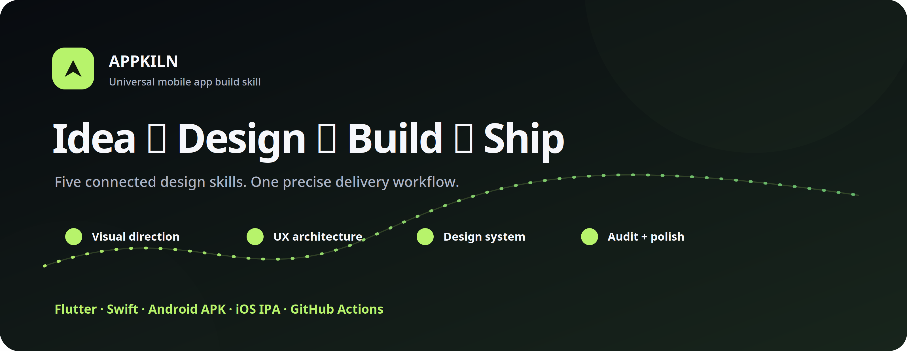
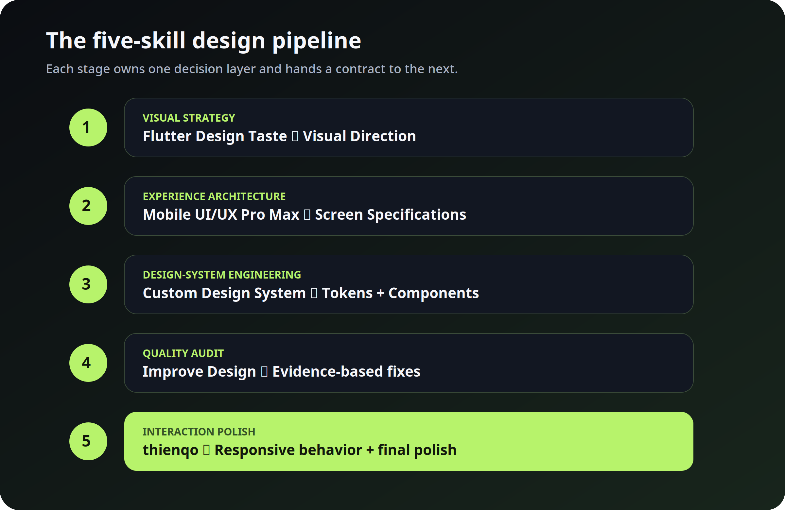
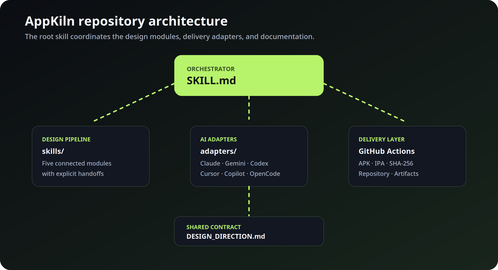

# AppKiln — Universal Mobile Build Skill



AppKiln turns an app idea into a polished Flutter or Swift mobile MVP. It connects five specialized design skills, selects the strongest product direction automatically, builds the app, publishes it to GitHub, and delivers a verified APK or IPA through GitHub Actions.

[](SKILL.md)
[](SKILL.md)
[](SKILL.md)
[](SKILL.md)
[](SKILL.md)
[](SKILL.md)
[](https://appkiln.pages.dev)
[](https://github.com/te3i/appkiln/releases/latest)

> **Official website:** [appkiln.pages.dev](https://appkiln.pages.dev)<br>
> **Repository releases:** [github.com/te3i/appkiln/releases](https://github.com/te3i/appkiln/releases)

## About AppKiln

AppKiln is a universal mobile product build skill for AI-assisted Flutter and Swift development. It coordinates five specialist design modules through explicit handoffs, then carries the implementation through GitHub and APK or IPA delivery. Read the full [About AppKiln guide](docs/about.md).

## AppKiln website

Visit the polished AppKiln landing page on [Cloudflare Pages](https://appkiln.pages.dev). The deployed site bundle is managed in Cloudflare; this repository stays focused on the skill, adapters, templates, examples, and documentation.

## Start with one request

```text
Build a Flutter expense tracker with categories, reports, local backup, and a polished dark mode. Use the complete five-module design pipeline, publish the project to GitHub, and deliver a verified APK.
```

The idea is not a fixed template. Use AppKiln for educational, social, financial, health, productivity, gaming, file utility, or project-specific apps.

## How the pipeline works



The five modules have explicit ownership and documented handoffs:

| Stage | Module | Owns | Handoff |
|---|---|---|---|
| 1 | [`flutter-design-taste`](skills/flutter-design-taste/SKILL.md) | Visual identity and design direction | Visual Direction |
| 2 | [`mobile-app-ui-ux-pro-max`](skills/mobile-app-ui-ux-pro-max/SKILL.md) | User flow, screens, hierarchy, and accessibility | Screen Specifications |
| 3 | [`flutter-custom-design-system`](skills/flutter-custom-design-system/SKILL.md) | Colors, typography, tokens, buttons, and reusable components | Design Tokens + Component Contract |
| 4 | [`flutter-improve-design`](skills/flutter-improve-design/SKILL.md) | Evidence-based review and quality fixes | Design Audit |
| 5 | [`flutter-ui-design-thienqo`](skills/flutter-ui-design-thienqo/SKILL.md) | Responsive implementation and interaction polish | Interaction Polish |

All handoffs are recorded in one shared [`DESIGN_DIRECTION.md`](templates/DESIGN_DIRECTION.md) contract.

## Repository architecture



- [`SKILL.md`](SKILL.md) — the main orchestrator and complete execution contract.
- [`skills/`](skills/) — the five connected design modules.
- [`adapters/`](adapters/) — instructions for Claude, Gemini, Codex, Cursor, GitHub Copilot, OpenCode, and any other AI.
- [`templates/`](templates/) — the shared design-direction template.
- [`examples/`](examples/) — precise request examples.
- [`docs/`](docs/) — About, architecture, pipeline, delivery documentation, and visual assets.

Read the detailed guides:

- [Architecture](docs/architecture.md)
- [Design pipeline](docs/design-pipeline.md)
- [Delivery workflow](docs/workflow.md)

## Platform delivery

- **Flutter + Android:** builds and uploads a verified APK on Ubuntu.
- **Flutter + iOS:** builds and uploads a verified IPA on macOS.
- **Swift + iOS:** builds and uploads a verified IPA on macOS.
- **Both artifacts:** creates both platform workflows when the user requests APK and IPA.

Every delivery includes the GitHub repository, successful Actions workflow, artifact URL, SHA-256 checksum, installation instructions, and a concise implementation report.

## Releases

Releases are reserved for meaningful, reviewable AppKiln milestones rather than random file changes. A release should document the workflow or design-contract changes, adapter updates, delivery behavior, documentation improvements, and any known limitations.

- [View all releases](https://github.com/te3i/appkiln/releases)
- [Current release: v1.0.0](https://github.com/te3i/appkiln/releases/tag/v1.0.0)

## Use with any AI

- Claude: [`adapters/claude/CLAUDE.md`](adapters/claude/CLAUDE.md)
- Gemini: [`adapters/gemini/GEMINI.md`](adapters/gemini/GEMINI.md)
- Codex: [`adapters/codex/AGENTS.md`](adapters/codex/AGENTS.md)
- Cursor: [`adapters/cursor/.cursorrules`](adapters/cursor/.cursorrules)
- GitHub Copilot: [`adapters/copilot/copilot-instructions.md`](adapters/copilot/copilot-instructions.md)
- OpenCode: [`adapters/opencode/AGENTS.md`](adapters/opencode/AGENTS.md)
- Any other model or coding agent: [`adapters/GENERIC.md`](adapters/GENERIC.md)

Every adapter follows the same root contract and five-module design pipeline.

## Contributing

Read [`CONTRIBUTING.md`](CONTRIBUTING.md) before changing the workflow or adding a module.
