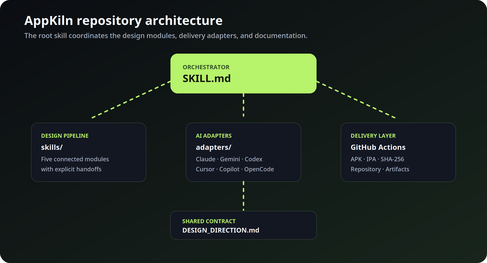

# AppKiln Architecture

AppKiln is organized around one orchestration skill and five specialized design modules. The root [`SKILL.md`](../SKILL.md) is the execution contract: it understands the request, coordinates the design pipeline, selects the platform, and manages validation and delivery.

## Core layers

| Layer | Location | Responsibility | Primary output |
|---|---|---|---|
| Orchestrator | [`SKILL.md`](../SKILL.md) | Understand the request, coordinate every stage, and manage delivery | Complete build plan and verified release |
| Design pipeline | [`skills/`](../skills/) | Define visual direction, UX, design system, audit, and interaction polish | `DESIGN_DIRECTION.md` and reusable UI |
| AI adapters | [`adapters/`](../adapters/) | Give Claude, Gemini, Codex, Cursor, Copilot, OpenCode, and any other AI the same repository contract | Consistent AI execution |
| Documentation | [`docs/`](.) and [`README.md`](../README.md) | Explain the workflow to people and AI systems | Discoverable repository |
| Delivery layer | GitHub Actions created for each app | Build the requested mobile artifact and checksum | APK or IPA plus SHA-256 |

## Execution flow

1. The AI reads the user's idea and extracts product, platform, artifact, and delivery requirements.
2. The AI reads all five design modules before making UI decisions.
3. The modules write one shared contract in `DESIGN_DIRECTION.md`.
4. The app is implemented from the approved tokens, components, screens, and state contracts.
5. The implementation is audited against the real product, then refined.
6. The requested GitHub Actions workflow builds the APK or IPA.
7. The repository, workflow, artifact, and SHA-256 are verified before delivery.

## Shared contract

`DESIGN_DIRECTION.md` is the handoff boundary between design decisions and implementation. It contains the product brief, visual direction, experience architecture, screen specifications, design tokens, component contract, state contract, design audit, and interaction polish decisions.

When two modules disagree, decisions follow this precedence:

1. Explicit user requirements.
2. Product goal and successful task completion.
3. Experience architecture and accessibility.
4. Approved visual direction.
5. Shared design-system tokens and reusable components.
6. Implementation-level polish and motion.

This keeps the five modules balanced: each one can improve the result, but no module silently takes ownership of another module's work.
