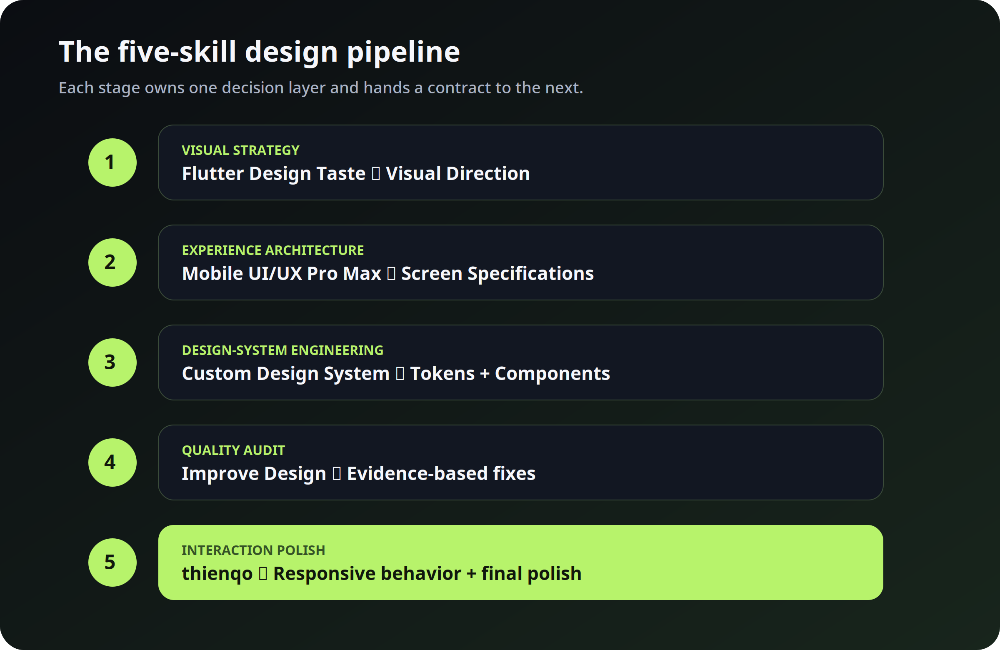

# AppKiln Design Pipeline

The five modules are a deliberate sequence. Each module has one primary responsibility, a clear boundary, and a concrete handoff.

## 1. Visual strategy

**Module:** [`flutter-design-taste`](../skills/flutter-design-taste/SKILL.md)

Defines the product personality, audience, emotional tone, visual direction, color philosophy, typography hierarchy, spacing rhythm, radius language, elevation, icon style, and visual signatures.

**Handoff:** `Visual Direction` in `DESIGN_DIRECTION.md`.

## 2. Experience architecture

**Module:** [`mobile-app-ui-ux-pro-max`](../skills/mobile-app-ui-ux-pro-max/SKILL.md)

Defines the user journey, information architecture, navigation, screen hierarchy, primary and secondary actions, validation, accessibility, responsive behavior, and complete screen states.

**Handoff:** `Experience Architecture` and `Screen Specifications` in `DESIGN_DIRECTION.md`.

## 3. Design-system engineering

**Module:** [`flutter-custom-design-system`](../skills/flutter-custom-design-system/SKILL.md)

Turns the approved direction and screen specifications into centralized tokens, themes, reusable components, and interaction states. Buttons, fields, cards, navigation, dialogs, feedback, loading, empty, and error states are defined here.

**Handoff:** `Design Tokens`, `Component Contract`, and `State Contract` in `DESIGN_DIRECTION.md`.

## 4. Quality audit

**Module:** [`flutter-improve-design`](../skills/flutter-improve-design/SKILL.md)

Reviews the real implementation and fixes issues in order: usability, hierarchy, accessibility, consistency, then visual polish. It checks realistic content, all important states, narrow screens, light/dark mode, and reduced motion.

**Handoff:** `Design Audit` with findings and completed fixes.

## 5. Interaction polish

**Module:** [`flutter-ui-design-thienqo`](../skills/flutter-ui-design-thienqo/SKILL.md)

Refines responsive layouts, safe areas, scrolling, keyboard behavior, purposeful motion, visible feedback, icon-only labels, and narrow-screen behavior without changing the approved visual language.

**Handoff:** `Interaction Polish` and final implementation refinements.

## What the AI must not do

- Do not choose colors in the screen implementation when the design tokens already define them.
- Do not invent one-off button styles when the component contract defines the button states.
- Do not skip loading, empty, error, success, disabled, or offline behavior.
- Do not redesign the product during polish without evidence from the audit.
- Do not let animation replace content, feedback, or accessible controls.
